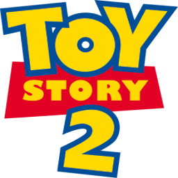

<h1>
  
  Toy Story 2 PC - Mod Manager (Tools)
</h1>

 

## About

Gemini is rapidly developing these tools to test the desired functionality within the mod manager and to serve as a foundation before they are integrated into it. However, they may also prove useful outside of the mod manager. Therefore, I am making them available to everyone.

## Tools

#### Conflict Manager
  
This simulation tool allows to experiment the future feature of managing the conflict between two mods (one enabled and one to enable) that both modify the same textures files. To know more about this tool, please refer to the `README.md` file inside the `conflict_manager` folder;

#### Texture Size Unlocker

This tiny tool checks if your toy2.exe game supports the high resolution textures (over 256x256 pixels) and lets you disable or enable this restriction on will.
To know more about this tool, please refer to the `README.md` file inside the `texture_size_unlocker` folder;

#### Tileset Editor
  
This tool allows to extract fragments of a tileset and inject it back into the tileset once you're done editing the fragments. To understand why I developed this tool, please refer to the `README.md` file inside the `tileset_editor` folder ;