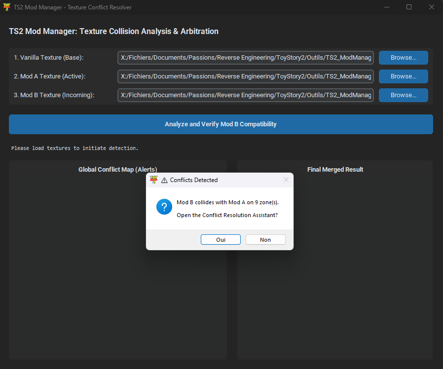
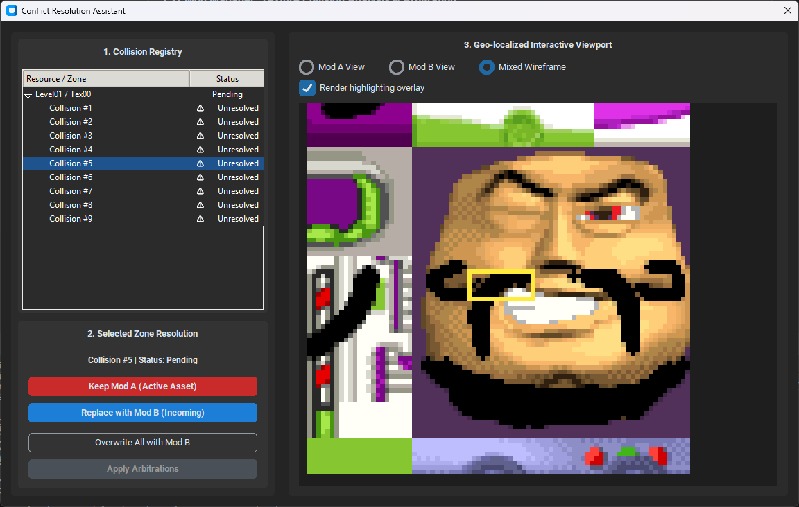
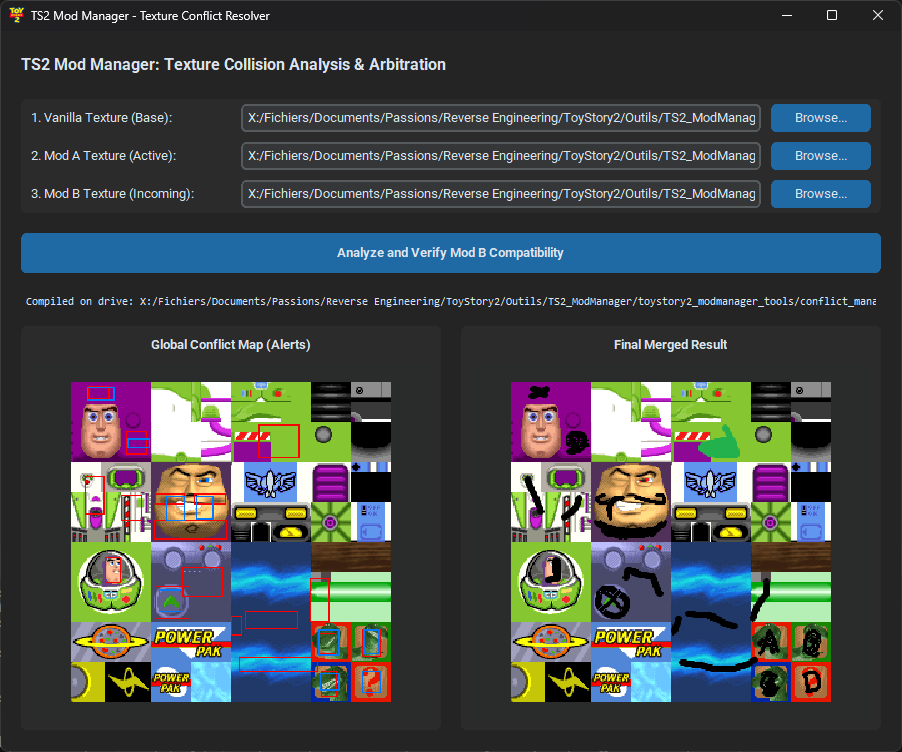

# Conflict Manager

### About

- This tool allows you to simulate the upcoming texture collision handling feature within the mod manager. This feature will let you analyze—by comparing them to the game’s original, unmodified textures—the differences between certain textures in mod “B” (which you want to enable) and certain textures in mod “A” (which is already active).

- Currently, if mod “A” affects certain textures and mod “B” affects the same textures, then if you activate mod “B” while mod “A” is active, mod “A” will be deactivated. Therefore, it is not currently possible to activate two mods at the same time that affect the same textures. The goal is to allow mods to coexist and be enabled together.

- However, we must take into account cases where both mods manipulate the exact same textures (down to the pixel) and provide a way to inform users of this conflict between the mods, allowing them to choose whether the changes from Mod “A” or Mod “B” will remain active.

- In this simulation, you can replay the conflict resolution scenario. For each texture collision, you can choose which modified texture fragment to use: the one from mod ‘A’ or the one from mod ‘B’. The final texture result (along with a map of the conflict zones) will be automatically generated in the `demo` folder once the resolution is complete.

### Demo data

You can find two tilesets within the `assets/demo` folder : `tex16_modA_enabled.bmp` is the tileset that simulates the role of the texture in a virtually already enabled mod "A" and `tex16_modB_to enable.bmp` is the tileset that simulates the role of the texture in a virtual mod "B" that we want to enable.

### How to run

You can launch the app with the command `python main.py` in your terminal.

### How to build the executable

Run the command `pyinstaller --onefile --windowed --name "Toy Story 2 - Tileset Editor" --icon "assets/ts2.ico" --add-data "assets;assets" main.py` in your terminal.

### Screenshots

<table>
  <tr>
    <td>
        
    </td>
    <td>
        
    </td>
    <td>
        
    </td>
  </tr>
</table>
