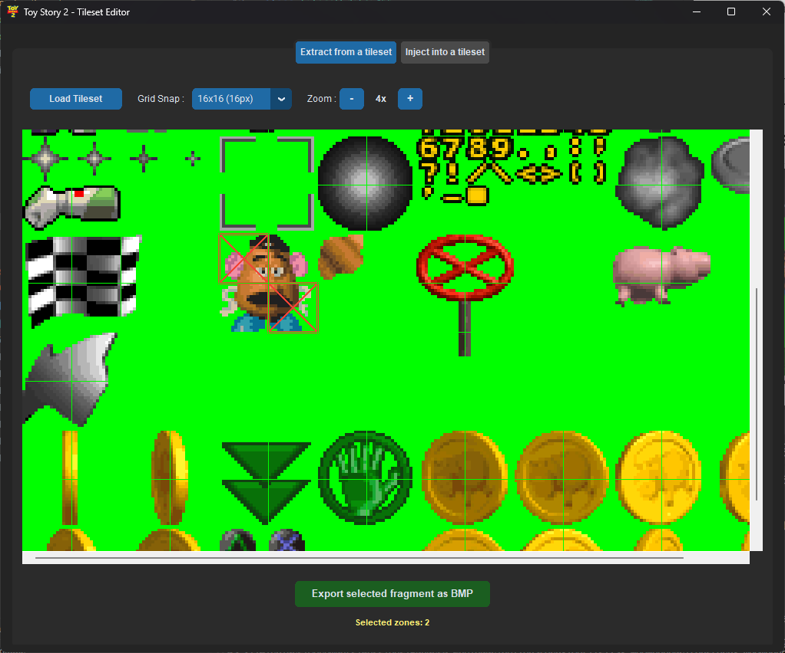
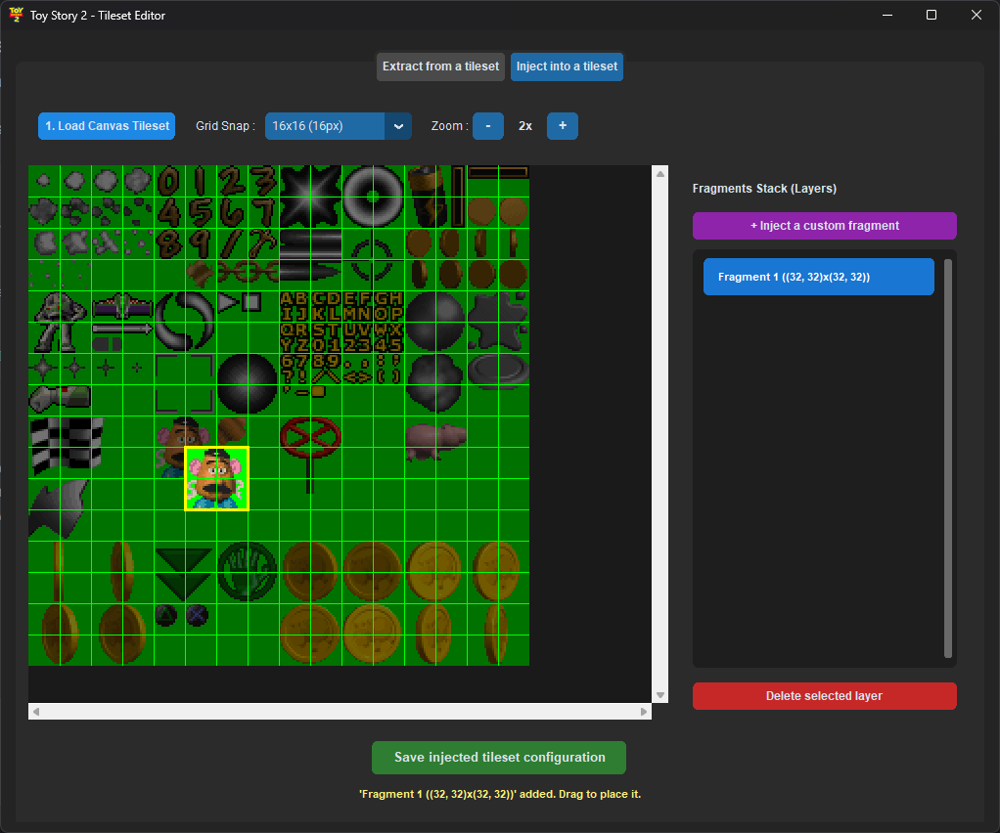

# Tileset Editor

### About

- This tool serves as a “Proof of Concept” for the feature that allows partial modification of game level textures. When you mod a game's textures, depending on your mod's concept, you may only need to modify one or two textures, with changes ranging from minor to major ;

- However—and this is particularly relevant for textures that are duplicated across all levels—if you need to make a minor change to a single texture, your mod’s .zip archive will contain the entire texture file, thereby increasing the size of your mod ;

- Ideally, your mod would contain only the modified texture segments, and the mod manager interface would let you specify which segment goes with which texture contained in which level’s .ngn file. You’d provide the mod manager with the ingredients and the recipe, and when you want to activate your mod, it would “cook” by generating the modified .ngn files for the levels.

### Demo data

You can find two tilesets within the `assets/demo` folder : `tex16.bmp` is the tileset that contain (among other things) Buzz's textures while `tex31.bmp` is the tileset that contain (among other things) the HUD elements.

### How to run

As this application requires CustomTkinter for the interface's style, make sure to install it with the command `pip install customtkinter` in your terminal. Once done, you can launch the app with the command `python main.py` in your terminal.

### How to build the executable

Run the command `pyinstaller --onefile --windowed --name "Toy Story 2 - Tileset Editor" --icon "assets/ts2.ico" --add-data "assets/ts2.ico;assets" --collect-all customtkinter main.py` in your terminal.

### Screenshots

<table>
  <tr>
    <td>
        
    </td>
    <td>
        
    </td>
  </tr>
</table>
